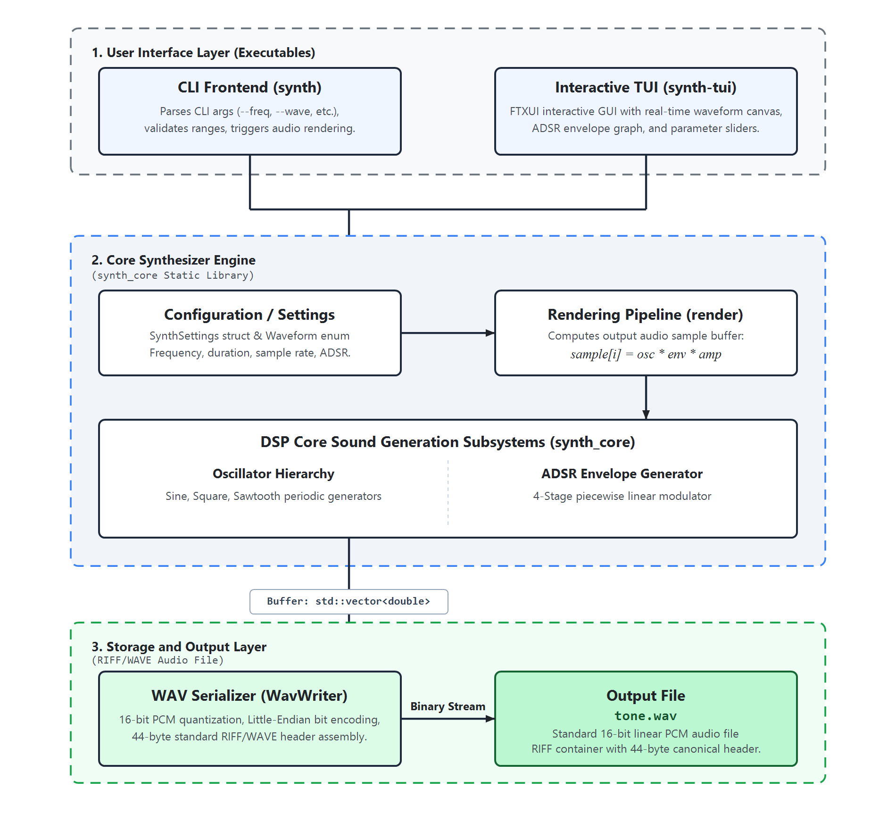
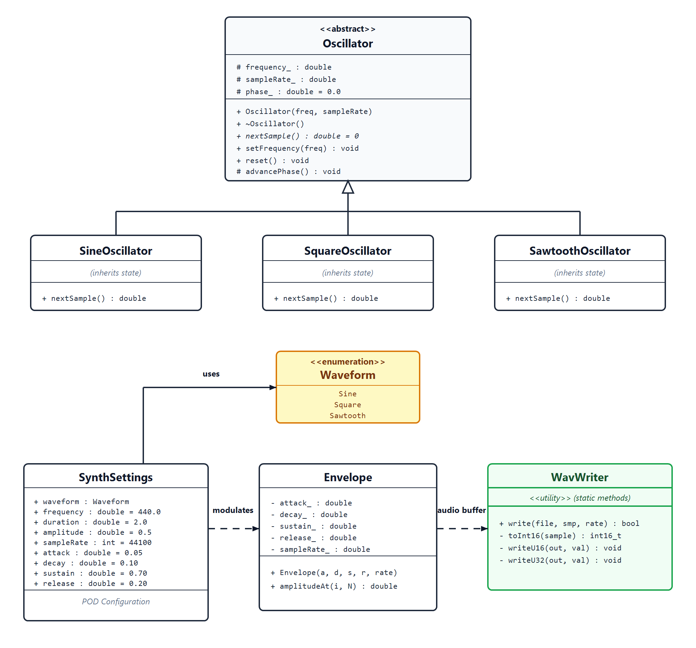

# Audio-WAV-Synthesizer

## Problem Statement
**Audio Synthesizer (WAV Generator):** Generate audible wave files (sine, square, sawtooth). Requires: Abstract Oscillator and Envelope classes, writing raw binary data using formatted C++ file streams.

### Team Members (Group 24)
- **Shailesh** (251150)
- **Sirthik** (251153)

---

## Overview
An audio WAV synthesizer generates sound digitally and outputs it into the standard WAV (Waveform Audio File Format) container format, storing uncompressed, high-fidelity pulse-code modulation (PCM) audio samples.

---

## System Architecture
The application is structured into a decoupled three-tier architecture:

1. **User Interface Layer (Executables):**
   - **CLI Frontend (`synth`):** Scriptable CLI parsing flags (`--freq`, `--wave`, `--adsr`, etc.), enforcing range validations, and triggering synthesis.
   - **Interactive TUI (`synth-tui`):** Modern FTXUI terminal interface featuring live Braille oscilloscopic waveform canvas, interactive ADSR curve visualization, and parameter sliders.

2. **Core Synthesizer Engine (`synth_core` Static Library):**
   - **Configuration / Settings:** `SynthSettings` struct and `Waveform` enum encapsulating frequency, duration, sample rate, and ADSR envelopes.
   - **Rendering Pipeline (`render`):** Computes audio sample buffers via:
     $$\text{sample}[i] = \text{osc}\to\text{nextSample}() \cdot \text{env} \cdot \text{amp}$$
   - **DSP Subsystems:** Pure virtual polymorphic `Oscillator` hierarchy (`SineOscillator`, `SquareOscillator`, `SawtoothOscillator`) and 4-stage piecewise linear `ADSR` envelope modulator.

3. **Storage and Output Layer:**
   - **WAV Serializer (`WavWriter`):** 16-bit PCM quantization, Little-Endian bit encoding, and standard 44-byte RIFF/WAVE header assembly written via unbuffered binary `std::ofstream`.
   - **Output File:** Standard 16-bit PCM `tone.wav`.

---

## UML Class Diagram

